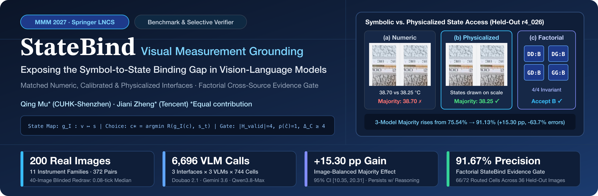
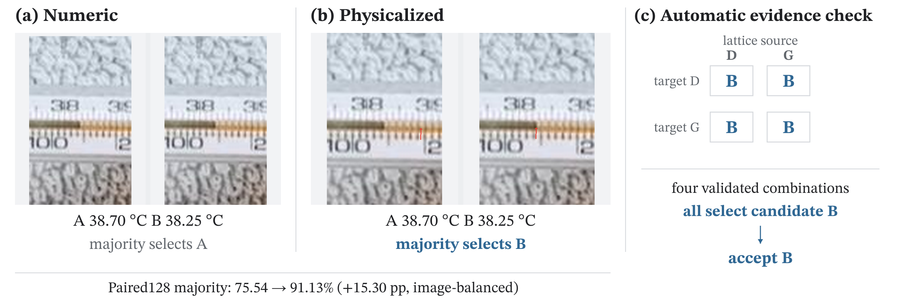
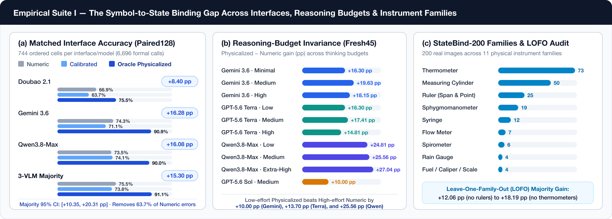
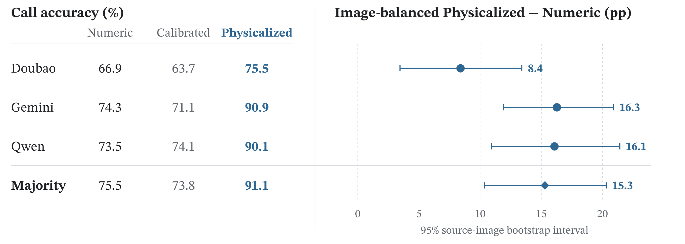
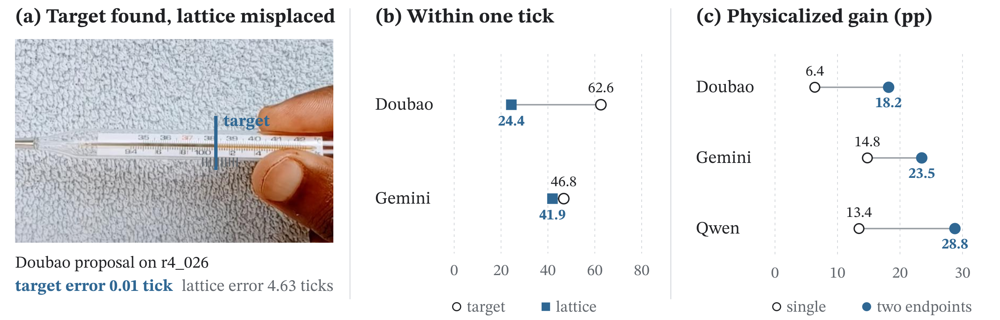
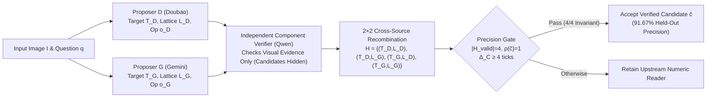
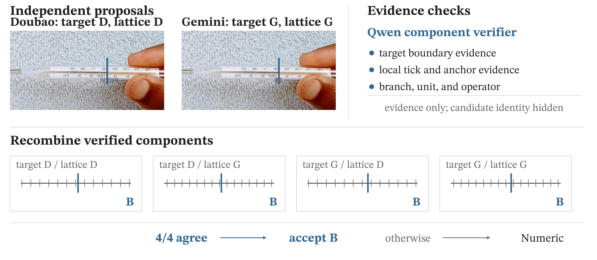
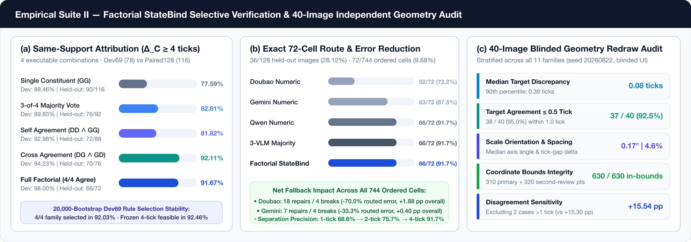
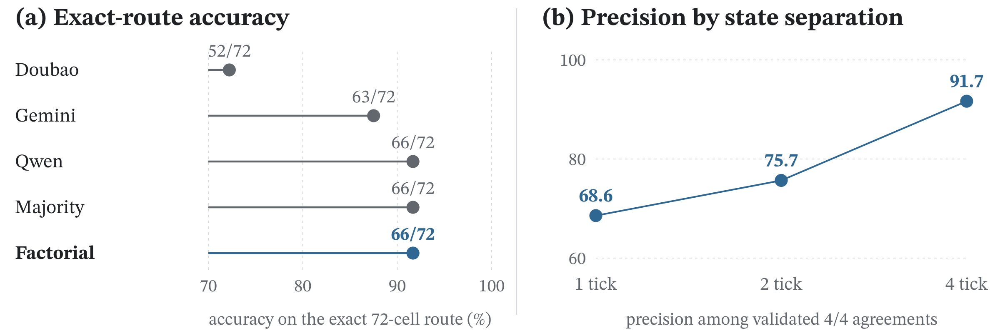

<div align="center">



<br/>

# StateBind: Exposing the Symbol-to-State Binding Gap in Visual Measurement

**Qing Mu**<sup>1,*</sup> · **Jiani Zheng**<sup>2,*</sup>  
<sup>1</sup>The Chinese University of Hong Kong, Shenzhen &nbsp;&nbsp;|&nbsp;&nbsp; <sup>2</sup>Tencent  
<sup>*</sup>Equal contribution (`qingmu@link.cuhk.edu.cn`, `ninajnzheng@tencent.com`)

[](paper/StateBind_MMM2027_CameraReady.pdf)
[](paper/StateBind_MMM2027_CameraReady.pdf)
[](data/)
[](records/)
[-16A34A?style=for-the-badge)](scripts/quick_verify.py)
[](LICENSE)

[**📄 Camera-Ready Paper**](paper/StateBind_MMM2027_CameraReady.pdf) · [**⚡ 30-Second Quickstart**](#-30-second-offline-verification) · [**📊 Empirical Dashboards**](#-empirical-results--visual-dashboards) · [**🔬 Factorial Verifier**](#-factorial-statebind-training-free-selective-verification) · [**🧭 Coordinate & Redraw Audit**](#-human-refined-geometry--40-image-blinded-redraw-audit) · [**🗂️ Repository Structure**](#-repository-architecture) · [**📝 Citation**](#-citation)

</div>

---

## 🌟 Overview & Key Highlights

Reliable vision systems must connect numerical claims to visible physical evidence. In **visual measurement**—reading thermometers, pressure gauges, graduated cylinders, syringes, and rulers—a model must not only identify the instrument and unit, but also bind candidate numerical values $v$ to their **image-specific physical states** $g_I(v)$ along the photographed scale.

**StateBind** introduces a causal representation intervention and an inference-time selective verification framework that isolate **instance-specific symbol-to-state binding** as a primary reliability bottleneck in modern Vision-Language Models (VLMs):

- **🧭 `StateBind-200` Benchmark**: Augments **200 real-world instrument photographs** across **11 physical instrument families** with human-refined local coordinate geometry (`Dev69` development pool + `New131` held-out pool; **128 paired-evaluation images**, **372 image–distance pairs**, **744 ordered cells** per interface/model, and **6,696 formal VLM evaluations**).
- **⚡ The Symbol-to-State Binding Gap (`+15.30 pp`)**: Holding the image, question, candidate values, candidate order, and scoring identical, rendering candidate states directly on the photographed scale (**Physicalized**) raises three-model majority accuracy from **75.54% to 91.13%**—an image-balanced gain of **+15.30 percentage points** (95% CI `[10.35, 20.31]`), eliminating **63.7%** of remaining symbolic errors.
- **🧠 Invariant to Calibration & Extra Reasoning**: Supplying oracle scale metadata (**Calibrated**: exact branch, unit, direction, and minor-tick value) leaves accuracy near **Numeric** (`73.79%` vs. `75.54%`). Increasing language-side thinking budgets across `Fresh45` leaves the Physicalized advantage intact (`+14.81` to `+27.04 pp`), proving that extra text reasoning cannot substitute for a missing image-specific state map.
- **🔀 `Factorial StateBind` Selective Verifier (`91.67%` Precision)**: A training-free, candidate-free multi-VLM evidence gate. Two VLMs (`Doubao`, `Gemini`) independently propose target and lattice geometry; an independent VLM (`Qwen`) validates visual component support without seeing candidate choices; and all $2 \times 2 = 4$ valid target–lattice source combinations are resolved deterministically.
- **📐 Blinded 40-Image Independent Geometry Redraw**: A stratified 40-image second-annotator audit across all 11 instrument families achieves a **0.08-tick median target discrepancy** (`37/40` within `0.5` tick, `38/40` within `1.0` tick) and preserves the main majority effect at **+15.54 pp** when excluding `>1`-tick cases.

<div align="center">
  
  <p><em><b>Figure 1 — Same numbers, different access to their physical states.</b> (a) <b>Numeric</b> presents two symbolic candidates (<code>38.70 °C</code> vs. <code>38.25 °C</code>), where the 3-VLM majority selects the wrong value. (b) <b>Physicalized</b> renders the exact same values at their scale states on the photograph, flipping the majority to the correct choice. (c) <b>Factorial StateBind</b> tests the candidate deterministically across all four validated target–lattice combinations.</em></p>
</div>

---

## 📊 Empirical Results & Visual Dashboards

### 1. The Symbol-to-State Binding Gap Across Interfaces, Reasoning & Families

<div align="center">
  
</div>

#### Matched Interface Comparison on Held-Out `Paired128` (744 Ordered Cells / Interface / Model)

| Reader / Ensemble | Numeric Call Acc. (%) | Calibrated Call Acc. (%) | Physicalized Call Acc. (%) | Image-Balanced $\Delta_{\text{P}-\text{N}}$ (pp) | 95% Source-Image Bootstrap CI |
| :--- | :---: | :---: | :---: | :---: | :---: |
| **Doubao Seed 2.1 Turbo** | 66.94% | 63.71% | **75.54%** | **+8.40 pp** | `[+3.47, +13.45]` |
| **Gemini 3.6 Flash** | 74.33% | 71.10% | **90.86%** | **+16.28 pp** | `[+11.69, +20.89]` |
| **Qwen3.8-Max** | 73.52% | 74.06% | **90.05%** | **+16.08 pp** | `[+10.74, +21.37]` |
| **Three-Model Majority** | 75.54% | 73.79% | **91.13%** | **+15.30 pp** | **`[+10.35, +20.31]`** |

<div align="center">
  
</div>

---

### 2. Mechanism Probes: Target Localization vs. Lattice Reconstruction & Span Burden

Why do VLMs fail under symbolic `Numeric` prompting even when they recognize the instrument? By inspecting raw geometric proposals before any human geometry is used:
- **Target–Lattice Asymmetry**: On held-out images, `Doubao` localizes the visual target boundary within `1.0` tick on **62.60%** of images (median error **0.45 ticks**), yet reconstructs the local tick lattice within `1.0` tick on only **24.39%** (median error **3.40 ticks**). Models frequently know *where* the liquid meniscus or pointer lies, but bind numerical anchors to the wrong local tick phase or spacing.
- **Two-Endpoint Ruler Spans Double the Binding Burden**: On 22 ruler-span images requiring two endpoint bindings ($\hat{z} = |s_{t,2} - s_{t,1}|$), `Physicalized` improves accuracy by **+18.18 pp** (`Doubao`), **+23.48 pp** (`Gemini`), and **+28.79 pp** (`Qwen`), compared with `+6.37`, `+14.78`, and `+13.44 pp` on 106 single-state images.

<div align="center">
  
  <p><em><b>Figure 3 — Mechanism probes of the binding gap.</b> (a) A real proposer output (<code>r4_026</code>) localizes the meniscus within <code>0.01</code> tick while misplacing the local lattice by <code>4.63</code> ticks. (b) Aggregate within-one-tick rates separate target localization from lattice construction. (c) Two-endpoint span measurements exhibit a substantially larger Physicalization gain than single-state readouts.</em></p>
</div>

---

## 🔬 Factorial StateBind: Training-Free Selective Verification

Oracle `Physicalized` uses human geometry to diagnose representational headroom. To turn this insight into an **automatic, training-free selective verifier** that uses **zero human geometry**, we introduce **Factorial StateBind**:



### Mathematical Formulation

Given image $I$, question $q$, and candidate set $\mathcal{C} = \{c_1, c_2\}$, two VLM proposers $D$ and $G$ output structured geometric hypotheses $P_r = (T_r, L_r, o_r)$. Projecting tick clicks $p_k$ and anchor pairs $(p_a, v_a)$ onto the oriented axis $\mathbf{u}$ with minor-tick value $\delta_v$ yields the deterministic 1D local scale map:

$$\delta_p = \operatorname{median}_k(p_{k+1} - p_k), \qquad \phi = \operatorname{median}_a\!\left(p_a - \frac{v_a}{\delta_v}\delta_p\right), \qquad \hat{p}(v) = \phi + \frac{v}{\delta_v}\delta_p$$

An independent component verifier (`Qwen`) inspects rendered visual crops of the proposed target, anchors, and local ticks **without access to candidate values A/B**. Validated components form four cross-source combinations $\mathcal{H} = \{(T_D, L_D), (T_D, L_G), (T_G, L_D), (T_G, L_G)\}$. Each valid combination $(T_i, L_j)$ deterministically resolves a reading $\hat{z}_{ij} = \Psi_{o_i}(T_i, L_j)$ and selects:

$$\hat{c}_{ij} = \arg\min_{c \in \mathcal{C}} \mathcal{R}(c; \hat{z}_{ij}), \qquad \rho(c) = \frac{\sum_{(i,j)\in\mathcal{H}_{\text{valid}}} \mathbf{1}[\hat{c}_{ij} = c]}{|\mathcal{H}_{\text{valid}}|}$$

Selected on `Dev69` (targeting $\ge 95\%$ precision) and applied **unchanged** to `Paired128`, the frozen **Precision Mode** requires:

$$|\mathcal{H}_{\text{valid}}| = 4, \qquad \rho(\hat{c}) = 1 \text{ (4/4 agreement)}, \qquad \Delta_{\mathcal{C}} = \frac{|c_1 - c_2|}{\delta_v} \ge 4 \text{ ticks}$$

<div align="center">
  
</div>

### Same-Support Attribution & Exact-Route Performance

<div align="center">
  
</div>

| Selective Verification Rule ($\Delta_{\mathcal{C}} \ge 4$ ticks, $|\mathcal{H}_{\text{valid}}|=4$) | Dev69 Correct / Routed | Dev69 Precision (%) | Held-Out Correct / Routed | Held-Out Precision (%) | Held-Out Cell Coverage (%) |
| :--- | :---: | :---: | :---: | :---: | :---: |
| **Single Constituent (`GG`)** | 69 / 78 | 88.46% | 90 / 116 | 77.59% | 15.59% |
| **3-of-4 Majority Vote** | 53 / 59 | 89.83% | 76 / 92 | 82.61% | 12.37% |
| **Self Agreement (`DD` $\wedge$ `GG`)** | 53 / 57 | 92.98% | 72 / 88 | 81.82% | 11.83% |
| **Cross Agreement (`DG` $\wedge$ `GD`)** | 49 / 52 | 94.23% | 70 / 76 | **92.11%** | 10.22% |
| **Full Factorial (`4/4` Agreement)** | **49 / 50** | **98.00%** | **66 / 72** | **91.67%** | **9.68%** (36/128 images) |

> **Why Cross-Source Recombination Matters**: A single proposer can shift both its target $T_r$ and lattice $L_r$ in the same direction while remaining internally coherent (`Self Agreement: 81.82%`). Swapping component sources across models (`DG` and `GD`) breaks coupled displacement errors, lifting held-out precision to **92.11%** (`Cross`) and **91.67%** (`Full Factorial`).

<div align="center">
  
</div>

---

## ⚡ 30-Second Offline Verification

This repository includes all frozen row-level evaluation ledgers, geometric annotations, and deterministic verification scripts. **No GPU, third-party Python packages, network access, or commercial VLM API keys are required** for record-level verification.

### 1. Run the One-Command Verification Suite

```bash
python3 scripts/quick_verify.py
```

Using only the Python standard library, `quick_verify.py` executes four independent verification stages in under 5 seconds:
1. **`scripts/verify_artifact.py`** — Audits all 14 JSONL ledgers and 4 JSON manifests for exact cardinalities, composite-key uniqueness, $3 \times 3$ model–interface matrix completeness, and repository hygiene.
2. **`scripts/rebuild_core_results.py`** — Recomputes all call-level and source-image-balanced accuracies from the 6,696-call ledger (`records/formal_calls6696.jsonl`).
3. **`scripts/rebuild_factorial_results.py`** — Reconstructs all 744 $2\times 2$ factorial recombinations (`records/factorial_cells744.jsonl`) and verifies the exact 72-cell selective route.
4. **`scripts/rebuild_geometry_audit.py`** — Verifies all 310 primary and 320 second-reviewer coordinate points against native image bounds and recomputes the 40-image independent redraw discrepancy and sensitivity metrics.

**Expected Terminal Output:**

```text
StateBind-200: 200 annotated images; Paired128: 128 images, 372 pairs, 744 ordered cells per interface/model, 6,696 formal calls
Majority: Numeric 75.54% -> Physicalized 91.13% (+15.30 pp)
Independent redraw: median 0.08 tick; 37/40 within 0.5 tick; 38/40 within 1 tick
Sensitivity excluding the two >1-tick redraws: +15.54 pp
Selective route: 66/72 correct (91.67%) across 36 images
Coordinate audit: 310 primary + 320 second-review points, all in bounds
Artifact checks: 74 text files scanned; credentials and private paths clean
PASS
```

### 2. Rebuild Paper Evidence Registry, Figures & Camera-Ready PDF

```bash
# Install lightweight plotting/PDF dependencies (Pillow & ReportLab)
python3 -m pip install -r requirements.txt

# Regenerate paper_evidence.json and LaTeX macro/table files from round3 summaries
python3 statebind_final/scripts/paper/build_evidence_registry.py

# Optional: Regenerate vector SVG/PDF/PNG figures
python3 statebind_final/scripts/paper/make_paper_figures.py

# Compile the Springer LNCS camera-ready manuscript with Tectonic
cd statebind_final/paper && mkdir -p build && tectonic -X compile main.tex --outdir build
```

---

## 🧭 Human-Refined Geometry & 40-Image Blinded Redraw Audit

### Coordinate Frame Conventions
- **Native Displayed-Image Pixel Frame**: All released final `*_xy` coordinates in `data/annotations/statebind200_geometry.jsonl` and `data/annotations/second_geometry40.jsonl` are stored in the **displayed image pixel frame** matching `image_width` and `image_height` in `data/source_index200.jsonl`.
- **Orthogonal Axis Projection**: `*_raw_xy` records the raw human click position; `*_xy` stores the point after orthogonal projection onto the marked 1D scale axis (`axis_start_xy` $\to$ `axis_end_xy`), where `low_value_tick_xy` $\to$ `high_value_tick_xy` defines the direction of increasing numerical value.
- **Blinded Second-Annotator Protocol**: A stratified 40-image sample (`seed = 20260822`; 14 from `Dev69`, 26 from `New131`, covering all 11 instrument families and `8 / 24 / 8` absolute-position, boundary-position, and span-difference cases) was independently redrawn using the standalone browser tool in `annotation_ui/statebind_second_annotator40/`. Primary coordinates, VLM predictions, evaluator answers, and sampling strata were hidden.

---

## 🗂️ Repository Architecture

```text
StateBind/
├── assets/                                  # High-DPI banners, empirical dashboards, and paper figures
│   ├── banner.png                           # Flagship project overview banner
│   ├── dashboard_binding_gap.png            # Empirical Suite I: Interfaces, Reasoning Budgets & Families
│   ├── dashboard_factorial_verifier.png     # Empirical Suite II: Factorial Attribution & Geometry Audit
│   └── fig1_teaser.png .. fig5_*.png        # Publication figures in high-resolution PNG format
├── src/statebind/                           # Core Python library for StateBind
│   ├── statebind.py                         # Local state mapping, candidate rendering & verification
│   ├── tick_coordinate.py                   # 1D axis projection and affine tick-lattice solver
│   ├── stimuli.py                           # Matched Numeric, Calibrated & Physicalized panel builder
│   ├── annotation.py                        # Geometry schema & validation utilities
│   ├── evaluation.py                        # Paired treatment-effect & cluster-bootstrap evaluators
│   ├── metrics.py                           # Selective prediction risk-coverage & precision metrics
│   └── prompts.py                           # Structured VLM proposer and component-verifier prompts
├── data/                                    # StateBind-200 benchmark annotations & experimental manifests
│   ├── source_index200.jsonl                # Stable MeasureBench IDs, dimensions, questions & provenance
│   ├── annotations/
│   │   ├── statebind200_geometry.jsonl      # 200 human-refined primary local state geometry records
│   │   └── second_geometry40.jsonl          # 40 independently redrawn blinded geometry audit records
│   └── manifests/
│       ├── pairs372.jsonl                   # 372 valid held-out image–distance pairs (d ∈ {1, 2, 4})
│       ├── cells744.jsonl                   # 744 ordered evaluation cells (primary & swapped orders)
│       ├── requests2232.jsonl               # 2,232 matched interface request specifications
│       ├── route_cells72.jsonl              # Frozen 72-cell Factorial StateBind precision route
│       └── geometry_audit40.jsonl           # Pre-outcome stratified 40-image geometry audit manifest
├── records/                                 # Complete offline VLM evaluation & verification ledgers
│   ├── formal_calls6696.jsonl               # 6,696 parsed responses (3 VLMs × 3 interfaces × 744 cells)
│   ├── factorial_cells744.jsonl             # 744 deterministic 2×2 target–lattice recombinations
│   ├── proposals/                           # Complete 200-image geometric proposals (Doubao & Gemini)
│   └── validators/                          # 375 independent Qwen visual component-validation records
├── round3/generated/                        # Derived statistical summaries & 20,000-bootstrap analyses
├── protocol/                                # Exact matched-interface protocol & prompt templates
├── annotation_ui/                           # Standalone browser-based geometry & tick-lattice redraw UI
├── scripts/                                 # Zero-dependency offline verification & reconstruction CLI
│   ├── quick_verify.py                      # One-command full verification entry point
│   ├── verify_artifact.py                   # Schema, cardinality & hygiene verifier
│   ├── rebuild_core_results.py              # Rebuilds Table 2 & matched-interface treatment effects
│   ├── rebuild_factorial_results.py         # Rebuilds Table 3 & Factorial StateBind route metrics
│   └── rebuild_geometry_audit.py            # Rebuilds 40-image redraw discrepancy & sensitivity checks
├── statebind_final/                         # Paper evidence registry builder, figure generator & LaTeX source
│   ├── paper/                               # Full Springer LNCS LaTeX source (main.tex, sections, tables)
│   └── scripts/paper/                       # Evidence registry & vector figure generation scripts
├── paper/
│   └── StateBind_MMM2027_CameraReady.pdf    # Compiled 14-page MMM 2027 Springer LNCS camera-ready PDF
├── DATA_NOTICE.md                           # Upstream MeasureBench provenance & CC BY-SA 4.0 attribution
├── LICENSE                                  # MIT License (code) & CC BY 4.0 (annotations)
├── pyproject.toml                           # Python package configuration
└── requirements.txt                         # Minimal dependencies for figure/PDF regeneration
```

---

## 📝 Citation

If you find **StateBind**, the **StateBind-200** geometry benchmark, or **Factorial StateBind** useful in your research, please cite our MMM 2027 paper:

```bibtex
@inproceedings{mu2027statebind,
  title     = {StateBind: Exposing the Symbol-to-State Binding Gap in Visual Measurement},
  author    = {Mu, Qing and Zheng, Jiani},
  booktitle = {Proceedings of the 33rd International Conference on Multimedia Modeling (MMM)},
  series    = {Lecture Notes in Computer Science (LNCS)},
  publisher = {Springer},
  year      = {2027},
  note      = {Equal contribution}
}
```

---

## 📜 License & Data Attribution

- **Code & Verification Pipeline**: Licensed under the [MIT License](LICENSE).
- **StateBind-200 Annotations & Evaluation Ledgers**: Released under [CC BY 4.0](LICENSE).
- **Source Instrument Photographs**: Adapted from [MeasureBench](https://github.com/flageval-baai/MeasureBench) (Lin et al., CVPR 2026) under CC BY-SA 4.0. See [DATA_NOTICE.md](DATA_NOTICE.md) for complete provenance and image attribution details.
